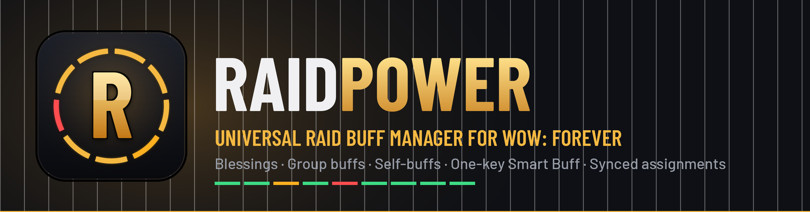
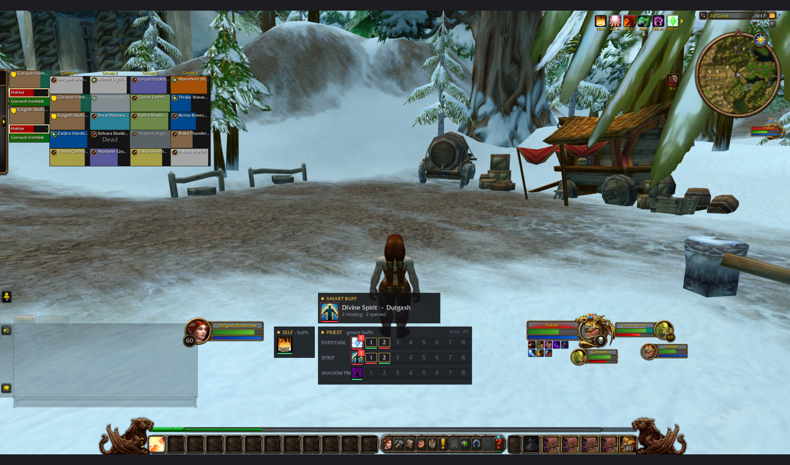
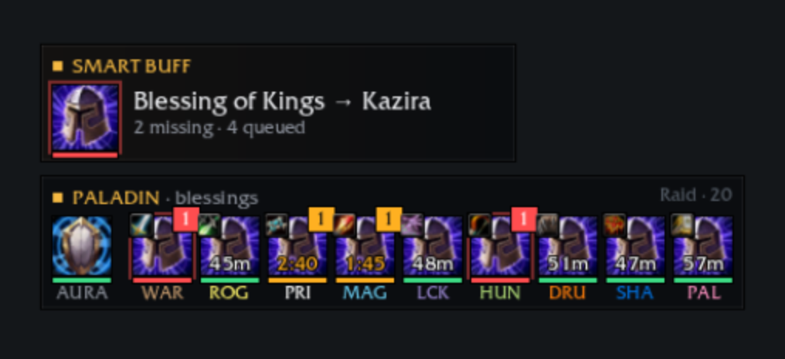
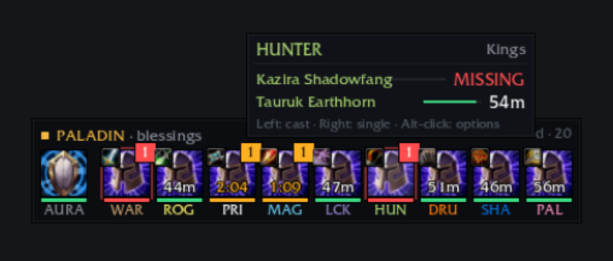
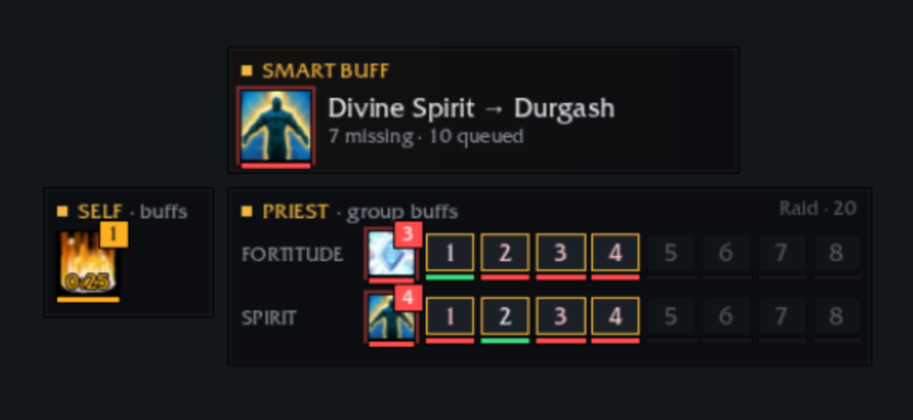
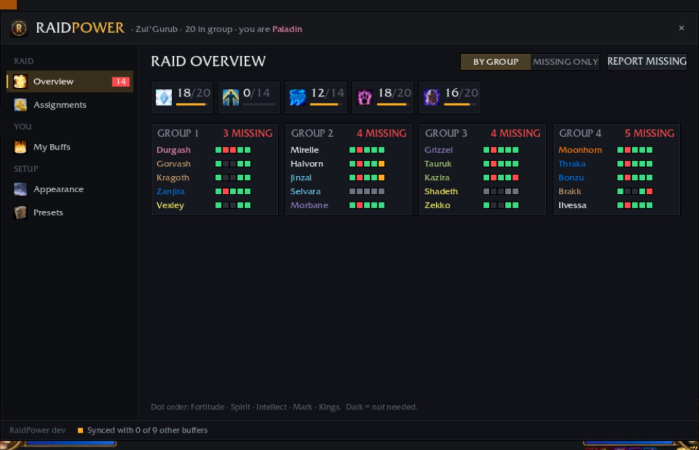
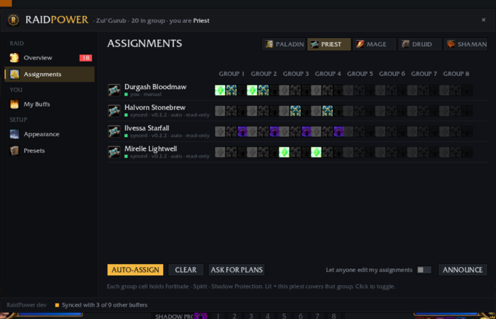
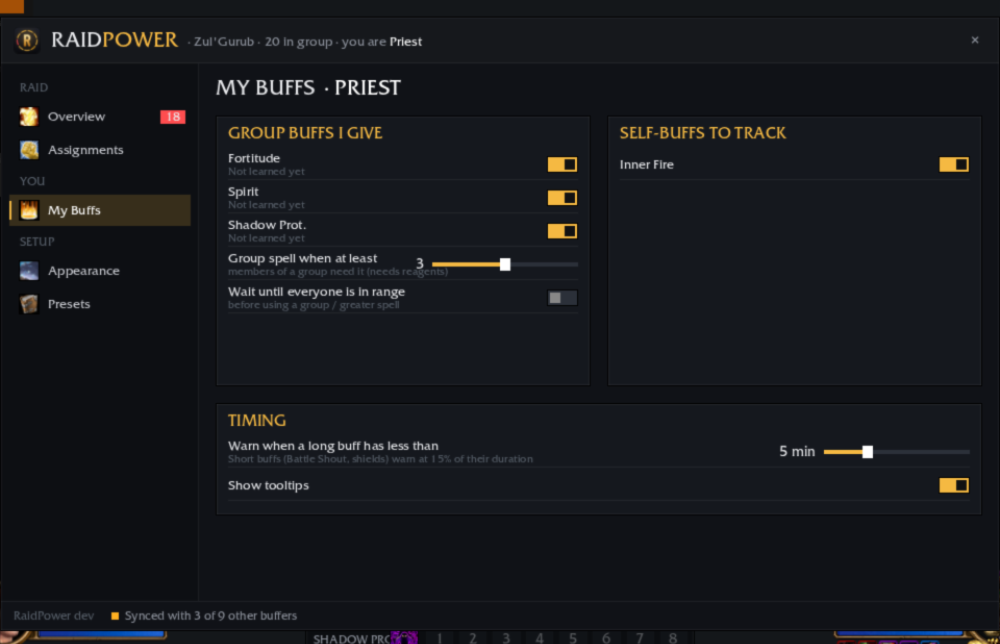
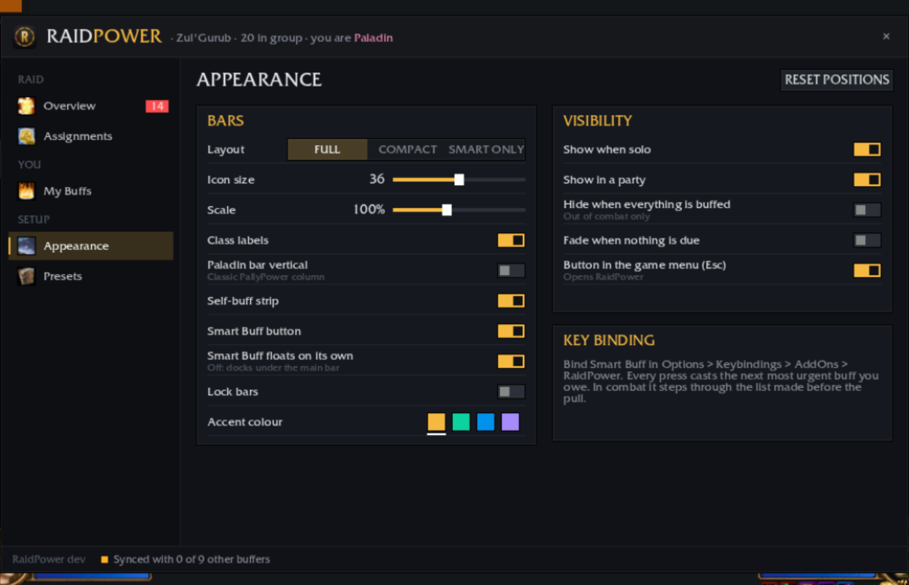

  

  
  
  
  

<b>PallyPower for the whole raid.</b> Assign, track and cast every class's buffs from one clean, modern UI. 
Paladins, priests, mages, druids and shamans share one plan, and every class gets its self-buffs tracked.

  

---

## ✨ Highlights

<table>
<tr>
<td width="50%" valign="top">

### 🛡️ Click-to-buff bars
Every tile is a button. **Left-click** casts on whoever needs it most, **right-click** casts the single-target version. Group and Greater versions are used automatically when enough players need them and you carry the reagent.

The **coloured underline** shows status: green buffed, amber expiring, red missing. The **badge** counts who's missing, and the **number** is the shortest time left.

</td>
<td width="50%" valign="top">

</td>
</tr>
<tr>
<td width="50%" valign="top">

</td>
<td width="50%" valign="top">

### 🔍 Who's missing what
Hover any tile for the player list, with each player's state and time left. It works in combat too.

### ⚡ Smart Buff
One button (and one key binding) that casts **the next most urgent buff you owe**: missing before expiring, group buffs before self-buffs. In combat it steps through the list made before the pull.

</td>
</tr>
<tr>
<td width="50%" valign="top">

### 👥 Group buffs per raid group
Priests, mages and druids get a row per buff, with a pill for each raid group. **Your** groups are outlined in gold. The self-buff strip sits beside it: Inner Fire, armors, shouts, aspects, shields, imbues and poisons.

</td>
<td width="50%" valign="top">

</td>
</tr>
</table>

## 🧭 The RaidPower window

Open it with `/raidpower`, from **Options → AddOns → RaidPower**, from the **Esc game menu**, or from the minimap addon list.

<table>
<tr>
<td width="50%">
<b>Overview</b>: every player's buffs at a glance, by group, with raid-wide totals and a one-click "report missing".
</td>
<td width="50%">
<b>Assignments</b>: split blessings per class and buffs per group. Synced live, and the leader and assists can edit every row.
</td>
</tr>
<tr>
<td width="50%">
<b>My Buffs</b>: choose what you give and which self-buffs to track, and tune when group or Greater spells are used.
</td>
<td width="50%">
<b>Appearance</b>: Full, Compact or Smart-only layout, size, scale, visibility, accent colour and the Esc-menu button.
</td>
</tr>
</table>

## 📦 Features

| | |
|---|---|
| **Paladin** | Blessings per class with per-player exceptions (e.g. Kings for the tank), Aura, Righteous Fury (always / when tanking / never), Salvation for non-tanks, Greater Blessings with Symbol of Kings |
| **Priest** | Fortitude, Divine Spirit and Shadow Protection per group (Prayer versions when worth it), Inner Fire |
| **Mage** | Arcane Intellect / Brilliance per group, armor of your choice |
| **Druid** | Mark / Gift of the Wild per group, Thorns on tanks, Omen of Clarity |
| **Shaman** | Totem plan per element, Lightning / Water Shield, weapon imbue |
| **Everyone else** | Battle Shout, aspects and Trueshot Aura, Demon / Fel Armor, rogue poisons per weapon |
| **Sync** | Plans are shared with everyone running RaidPower. Auto-assign gives every client the same split even without a leader, and presets save a raid's setup |
| **Combat-safe** | Forever hides auras in combat; RaidPower keeps the last known state with timers still counting down, so bars don't turn red mid-pull |

## 📥 Install

- **CurseForge:** install from the [CurseForge page](https://www.curseforge.com/projects/1780799) or the CurseForge app.
- **Manual:** download `RaidPower-vX.Y.Z-forever.zip` from [Releases](https://github.com/glitchv0/Raid-Power/releases/latest) and extract it into `World of Warcraft/_forever_/Interface/AddOns/`.

Then bind **Smart Buff** under *Options → Keybindings → AddOns → RaidPower*.

## ⌨️ Commands

| Command | |
|---|---|
| `/raidpower` | Open / close the window |
| `/raidpower auto` | Auto-assign buffs |
| `/raidpower report` | Report missing buffs to the group |
| `/raidpower lock` · `unlock` | Lock or unlock the bars |
| `/raidpower reset` | Reset bar positions |
| `/raidpower show` · `hide` | Show or hide the bars |

---

<b>🛠️ Development and releases</b>

### Branches
Every change goes into `main` through a pull request. PRs build a test zip, attached to the workflow run, and publish nothing.

### Releasing
Merging a PR into `main` runs `.github/workflows/release.yml`:

1. It picks the next version from the last `v*` tag. A commit mentioning `BREAKING` (or `feat!:`) bumps the major version, `feat...` the minor, anything else the patch.
2. It tags the commit and runs [BigWigsMods/packager](https://github.com/BigWigsMods/packager), which fills `@project-version@`, builds the zip and creates the GitHub release with a changelog.
3. It uploads to **CurseForge** (project `1780799`) when the `CF_API_TOKEN` secret is set, and to **Wago** when the `WAGO_API_TOKEN` secret and the `WAGO_PROJECT_ID` variable are set.

Put `[skip release]` in the merge commit message to merge without releasing. **Actions → Release → Run workflow** forces a patch, minor or major release.

### Testing
The screenshots above were taken in the [UIForever](https://uiforever.com/app?flavor=forever) browser simulator for Forever, using a custom raid scenario. The simulator doesn't cast spells, so it can't show a buff landing; casting needs a real client. `docs/mockup/index.html` is the original UI mock-up.

